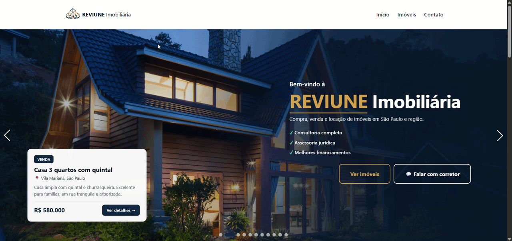
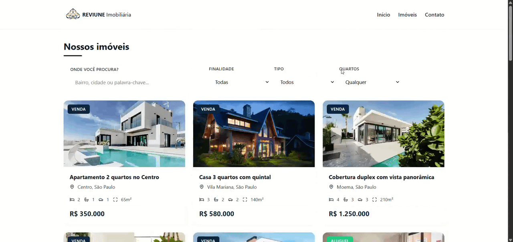
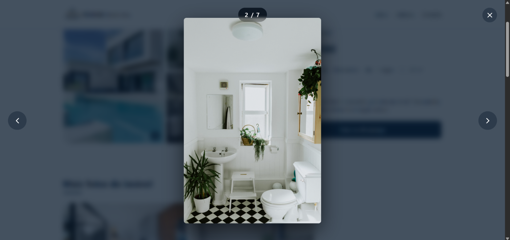
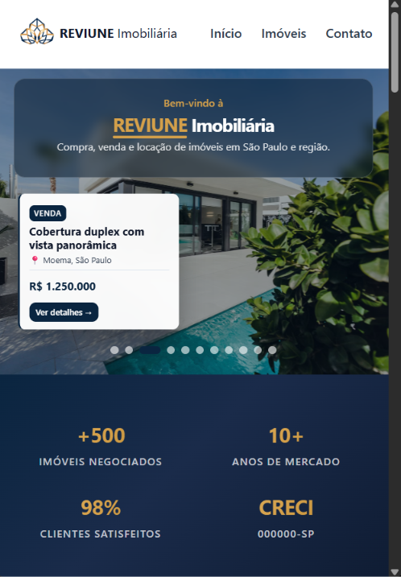
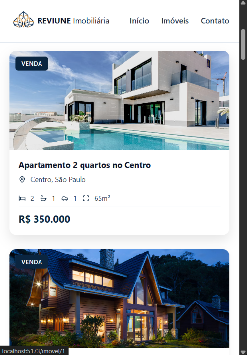

  
  <h1>REVIUNE Imobiliária</h1>
  
Exemplo de site imobiliário moderno para compra, venda e locação de imóveis em São Paulo e região.

  
  
  
  
  

### Página Inicial

Página com carrossel automático com os imóveis em destaque, introdução, barra de pesquisa, imóveis, diferenciais da corretora, anuncie aqui e FAQ.

 

### Imóveis

Página que mostra os imóveis com filtragem, que ao clicar em um especifico, é mostrado imagens e informações do imóvel, comodidades, localização e imóveis similares.

 

### Imagens dos imóveis

Galeria com lightbox onde se clicar em uma imagem, ela é expandida em tela cheia.

 

### Responsividade

Interface dinâmica que se adapta a diferentes resoluções.

  
  

